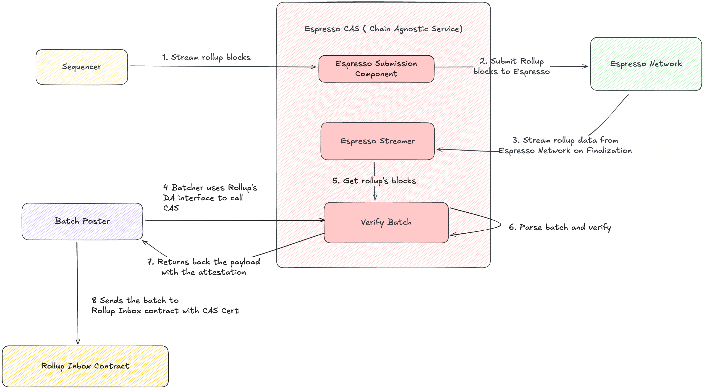

# Chain Adjacent Service

Chain Adjacent Service (CAS) connects Arbitrum Nitro rollups to Espresso. It implements the rollup's data availability (DA) API and checks that proposed batches follow the ordering agreed upon by Espresso.

After verification, CAS returns a certificate to the batch poster. The certificate contains a signature from the trusted execution environment (TEE) and the metadata needed for on-chain validation by the `SequencerInbox` contract.

**Currently supported:** Arbitrum Nitro (v3.9.9 and v3.10).

## Architecture



Key modules under `src/`:

| Module | Purpose |
| --- | --- |
| `da_api/` | JSON-RPC DA provider server (axum). Handles `Store`/`GetByHash` and supports calldata + AnyTrust providers. |
| `streamer/` | Polls Espresso blocks, extracts namespace transactions, manages verification queue. |
| `submitter/` | Batches feed messages and submits Espresso transactions. |
| `espresso_client/` | Query-service client and verified light-client reader for Espresso. |
| `key_manager/` | TEE key management (AWS Nitro Enclaves), attestation verification, on-chain signer registration. |
| `rollups/` | `Rollup` trait definition + Nitro implementation (batch parsing, L1 monitor, feed relay). |
| `secrets.rs` | AWS Secrets Manager integration for runtime secret overrides. |
| `config.rs` | JSON configuration deserialization. |

## Feature flags

Nitro protocol versions are mutually exclusive features:

| Feature | Description |
| --- | --- |
| `nitro-v3_9_9` (default) | Arbitrum Nitro v3.9.9 protocol |
| `nitro-v3_10` | Arbitrum Nitro v3.10 protocol |

Build for a specific version:

```bash
cargo build --release --no-default-features --features nitro-v3_10
```

## Development

### Prerequisites

- **Rust 1.94.1** (pinned in `rust-toolchain.toml`)
- **Docker** (for E2E tests)

### Getting started

```bash
# Ensure rustup picks up rust-toolchain.toml automatically.

# Verify prerequisites
just check

# Build
just build

# Check formatting
just fmt

# Clippy (pick one — features are mutually exclusive)
just clippy-v3_9_9
just clippy-v3_10
```

## Configuration

CAS reads a JSON config file specified via CLI or environment variable:

```bash
chain-adjacent-service --config /path/to/config.json
```

Secrets can be injected at runtime via AWS Secrets Manager — see [`.env.example`](.env.example) for the required environment variables.

### Log verbosity

The log filter uses `RUST_LOG` syntax and starts from the `RUST_LOG` environment variable (default `info`).

In the Nitro enclave `RUST_LOG` is baked into the image and therefore into PCR0. To change verbosity without rebuilding and re-registering the image, set the optional `log_filter` field in the AWS secret (e.g. `"log_filter": "debug"`) and restart the enclave; it is applied right after the secret is read. If `log_filter` sets no overall level (e.g. `"light_client=debug"`), `info` is kept for everything else, so module-specific filters retain the default level elsewhere.

## Running

### Binary

```bash
just build
./target/release/chain-adjacent-service --config config.json
```

### Docker

```bash
# Default build (Nitro v3.9.9)
just docker-build

# Nitro v3.10
docker build --build-arg CARGO_FEATURES=nitro-v3_10 -t cas:v3.10 .

# Run
docker run -v /path/to/config.json:/etc/cas/config.json cas:v3.10
```

The image runs as a non-root user and expects the config at `/etc/cas/config.json` by default.

See [CAS images and enclave builds](docs/image-builds.md) for published version tags, the `tee-image-builder` inputs, and the distinction between Nitro version and Espresso network.

## Testing

### Unit and integration tests

```bash
just test
```

Runs the tests separately for Nitro 3.10 and 3.9.9, with one test thread per run.

### E2E tests

End-to-end (E2E) tests start a full Nitro stack through Docker Compose.

```bash
# Nitro v3.10 (default)
just test-e2e

# Nitro v3.9.9 (requires generated L1 state)
just generate-l1-state-v3_9_9
just test-e2e-v3_9_9

# Optional: filter to a specific test
just test-e2e test_e2e_anytrust
```

### Docker Compose helpers

```bash
just e2e-up              # Start Nitro v3.10 stack
just e2e-down            # Stop Nitro v3.10 stack
just e2e-up-v3_9_9       # Start Nitro v3.9.9 stack
just e2e-down-v3_9_9     # Stop Nitro v3.9.9 stack
just clean               # Tear down all leftover E2E containers
```

## Documentation

- [Overview](docs/light-client-integration.md): CAS's role and how verified reads fit together.
- [Technical reference](docs/light-client-reference.md): source entry points, config and API behavior.
- [Catch-up and genesis verification](docs/light-client-catchup.md): detailed diagrams, network assumptions and validation commands.
- [Image builds](docs/image-builds.md): Nitro-version selection, publishing and enclave build inputs.

For operators, [hosting CAS](docs/cas-deployment-topology.md) maps the required service connections and the boundaries between enclave configuration and host networking.

## CI

GitHub Actions runs on every push to `main` and on pull requests:

| Job | What it does |
| --- | --- |
| **Formatting** | `cargo fmt --all --check` |
| **Tests** | `cargo test --all-targets` |
| **Clippy** | Runs separately per Nitro version (mutually exclusive features) |
| **Audit** | `cargo audit` via rustsec |

## License

Copyright (c) 2022 Espresso Systems espresso-network was developed by Espresso Systems. While we plan to adopt an open source license, we have not yet selected one. As such, all rights are reserved for the time being. Please reach out to us if you have thoughts on licensing.

## Disclaimer

DISCLAIMER: This software is provided "as is" and its security has not been externally audited. Use at your own risk.

DISCLAIMER: The Rust library crates provided in this repository are intended primarily for use by the binary targets in this repository. We make no guarantees of public API stability. If you are building on these crates, reach out by opening an issue to discuss the APIs you need.
