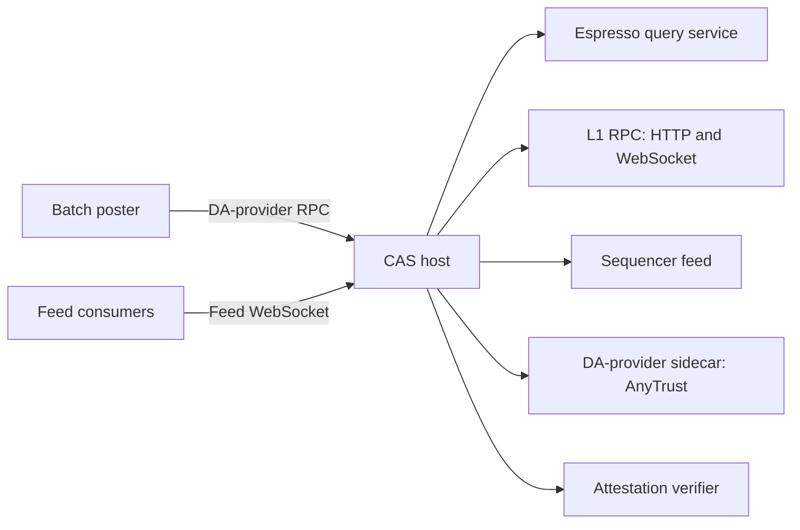

# Hosting CAS: connections and configuration

This guide describes the connections an operator needs when hosting CAS for an Arbitrum Nitro rollup. The services can share a network or be hosted separately.

Use [image builds](image-builds.md) for version selection, enclave builds and registration. The [light-client overview](light-client-integration.md) explains what CAS verifies; the [technical reference](light-client-reference.md) documents its reader configuration.

## Connection map

Arrows point from the client initiating a connection to the service it connects to.

The CAS operator needs reachable endpoints for the services on the right. These can be hosted by the same operator or supplied by other service operators. The rollup's batch poster and feed consumers need reachable CAS endpoints on the left.

## Inbound connections

The following are example ports from the enclave configuration. Confirm the actual values in the selected chain config and the enclave host's inbound port mappings before exposing them.

| Service | Example port | Configuration / caller |
| --- | --- | --- |
| DA-provider HTTP JSON-RPC | `8000` | `da_server.listen_addr`; the batch poster calls `/cas/arb/anytrust` for AnyTrust |
| Signed feed WebSocket | `9643` | `feed.server.ws_server.port`; consumers configure `node.feed.input.url` |

The host must forward these connections into the enclave. Configure routing and inbound rules for the intended callers; a load balancer and separate networks are deployment choices, not CAS requirements.

Nitro's DA-provider flag names differ between versions. Use the [3.10 Compose configuration](../e2e/nitro/docker-compose.yml) or the [3.9.9 override](../e2e/nitro/docker-compose.v3_9_9.yml) matching the rollup.

## Outbound connections

| Dependency | Purpose |
| --- | --- |
| Espresso query service | Transaction submission and verified reads; optional fallback URLs serve reads |
| L1 RPC, HTTP and WebSocket | Rollup contract queries and L1 monitoring |
| Sequencer-feed WebSocket | Incoming rollup messages for submission to Espresso |
| DA-provider sidecar | Downstream data availability operations when using AnyTrust |
| Attestation verifier | Attestation checks used by the key-management flow |
| AWS Secrets Manager and any required AWS authentication/KMS endpoints | Runtime secret retrieval for the Nitro deployment |

For enclave deployments, configure the host's outbound proxy and allowed destinations for the selected endpoints. Check the selected builder configuration in `tee-image-builder/aws-nitro/cas/enclaver/enclaver.yaml`; networking rules must cover the actual hostnames and ports used by the deployment.

## Configuration boundaries

Before building, select the rollup identity, Nitro variant, attestation verifier and Espresso genesis. Follow the [image guide](image-builds.md#build-the-enclave-in-tee-image-builder) for the configuration included in the image and the resulting enclave identity. The [genesis guide](light-client-catchup.md#genesis-configuration-and-network-identity) describes the trusted initial network configuration.

Supported runtime endpoint and operator overrides are defined by [`SecretOverrides`](../src/secrets.rs). They do not make every baked configuration field runtime-overridable. Log-filter precedence is documented in the [README](../README.md#log-verbosity).

Endpoint overrides, host networking rules and enclave access policies are separate settings. For example, changing a feed URL in the runtime secret may also require an outbound-rule update; a batch poster's source IP belongs in the host's inbound rules. The config hash check does not provision IAM or attestation/KMS access policies.
