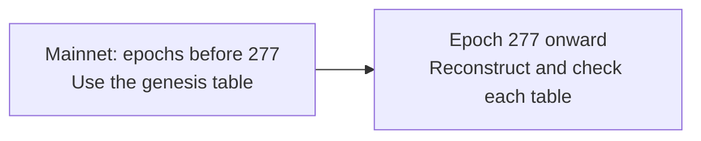
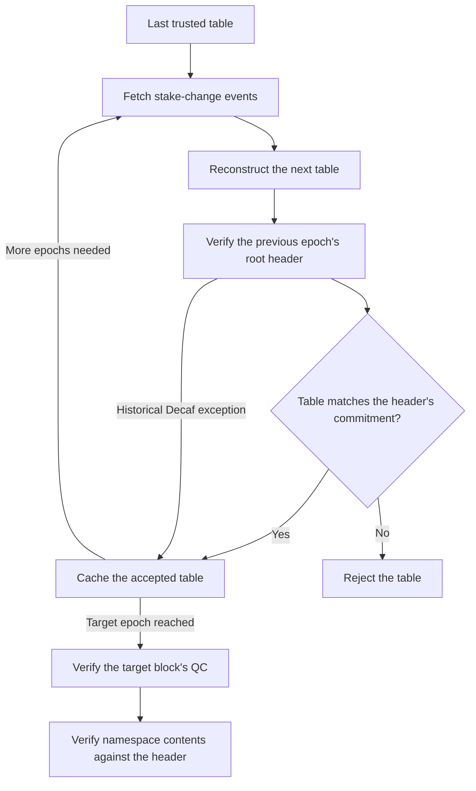

# Light client catch-up and genesis verification

This guide explains how the light client checks changes to the validator set and how to validate the committed Mainnet and Decaf genesis files. Start with the [overview](light-client-integration.md) for CAS's role, or use the [technical reference](light-client-reference.md) to find the relevant code and APIs.

## Network context and terminology

Espresso's validators use HotShot consensus to agree on finalized blocks. The light client checks the evidence returned by query nodes without participating in consensus. The examples below use Mainnet; the genesis configuration also covers Decaf.

| Term | Meaning |
| --- | --- |
| Leaf | A consensus record containing a block header and quorum-certificate information |
| Quorum certificate (QC) | Validator signatures establishing agreement by the required stake threshold; the client checks these against the validator set |
| Stake table | Validator public keys and stake weights for an epoch |
| Epoch | A span of `epoch_height` blocks associated with a validator set; see the [network parameters](#genesis-configuration-and-network-identity) |
| Genesis | Trusted initial network parameters and validator set, supplied independently of the query node |
| Catch-up | Reconstructing and checking later validator sets from genesis or previously verified state |

## Why catch-up exists

Validators and their stake weights change over time. To verify a block in epoch *N*, the client needs that epoch's stake table. It starts from the trusted genesis table and checks the changes leading to the required epoch.



`first_epoch_with_dynamic_stake_table` marks this boundary. Its value depends on the network, as shown in [genesis configuration](#genesis-configuration-and-network-identity).

## Catch-up verification

Starting from genesis or a cached table, the client repeats the following steps until it has the validator set needed for the target block:



The node returns stake-change events through `GET /light-client/stake-table/{epoch}`. Replaying those events produces a candidate table. The client verifies the previous epoch's root header using the validator sets required at that epoch boundary, then compares the candidate's hash with the header's `next_stake_table_hash`. This commitment is the hash recorded by consensus for the next validator set. A mismatch causes verification to fail.

The [historical Decaf exception](#historical-decaf-compatibility-assumption) applies only to certain older roots that lack this commitment. All these checks run in the light client; query nodes supply the data and proofs.

Two checks establish different properties: the table commitment authenticates validator changes, and the target block's QC signatures establish finality using that validator set. The namespace proof is then checked against the verified header.

Catch-up work grows with the history that must be replayed. A persistent cache can retain previously verified state; see the [cache configuration](light-client-reference.md#cas-adapter-and-configuration).

## Genesis configuration and network identity

`espresso_client.light_client.genesis` deserializes as the upstream `Genesis` structure. Its fields describe the trusted initial configuration:

| Field | Meaning |
| --- | --- |
| `epoch_height` | Blocks per epoch |
| `first_epoch_with_dynamic_stake_table` | First epoch whose table is derived from stake-table contract events |
| `stake_table` | Initial validators, each with `stake_key` and `stake_amount` |
| `chain_id` | Required Espresso network identifier; selects behavior specific to that network |

| Network | `chain_id` in JSON | `epoch_height` | First dynamic epoch | Initial validators |
| --- | --- | --- | --- | --- |
| Mainnet | `1` | `40000` | `277` | `100` |
| Decaf testnet | `"0xdecaf"` | `3000` | `1056` | `100` |

This is the Espresso chain ID, separate from the rollup's `rollup.stack.chain_id` and its Nitro protocol version. The previous `decaf` flag is no longer the config interface. CAS logs the configured ID/name; that log does not independently check the server's network.

### Source files and updates

At Espresso revision `02794853a06`, the upstream genesis files are `crates/light-client-query-service/genesis/{mainnet,decaf}.toml` in espresso-network. The JSON consumed by enclave builds is committed in `tee-image-builder/chain-configs/cas/genesis/{mainnet,decaf}.json`, including the required network identifier. Review the JSON against the intended network's published genesis rather than learning a production root of trust from an untrusted server at startup.

The initial configuration stays fixed as validators change. Later tables are derived by catch-up. The file schema can evolve with client upgrades; adding `chain_id` does not change the network's history.

The enclave builder merges the selected JSON into the configuration included in the image and its measurement. Genesis cannot be replaced through AWS runtime secret overrides. See [image builds](image-builds.md#build-the-enclave-in-tee-image-builder) for the steps required when changing this configuration.

### Historical Decaf compatibility assumption

Older Decaf epoch-root headers exist, but some use a format from before the DRB/header upgrade and lack `next_stake_table_hash`. Normally that field authenticates the reconstructed table in the [catch-up verification flow](#catch-up-verification).

For those roots only, when `chain_id = "0xdecaf"`, the client trusts the server's stake-table events without checking the missing commitment. Other proof verification still runs. Mainnet does not get this exception: a required missing commitment fails verification. This distinction is why using the correct chain ID matters beyond labeling.

## Validating the committed genesis files

The tests are implemented in [`src/espresso_client/light_client.rs::light_client_tests`](../src/espresso_client/light_client.rs). From CAS, with a sibling `tee-image-builder` checkout:

```bash
DECAF_GENESIS=../tee-image-builder/chain-configs/cas/genesis/decaf.json \
  cargo test --lib light_client_tests::decaf_genesis_catches_up -- --ignored --nocapture

MAINNET_GENESIS=../tee-image-builder/chain-configs/cas/genesis/mainnet.json \
  CAS_LOG_FILTER=info,light_client=debug \
  cargo test --lib light_client_tests::mainnet_genesis_catches_up -- --ignored --nocapture
```

Both tests read the actual JSON file rather than reconstructing a substitute fixture. They check chain ID, epoch parameters and initial validator count, then exercise the transition to changing validator sets. Decaf targets epoch 1058, crossing its boundary at 1056. Mainnet targets epoch 278, crossing its boundary at 277, and verifies a block count beyond the range covered by the genesis table. Both tests require live query nodes and are ignored in ordinary CI.

The same source file also tests that `chain_id` survives config deserialization and is required. `decaf_catches_up_past_missing_stake_table_hash` is the ignored live regression case that checks the historical Decaf assumption separately.

## Historical verification logs

Shortened excerpts from earlier Mainnet experiments; the old `live_smoke` harness is no longer included. Use the [current genesis tests](#validating-the-committed-genesis-files) to reproduce the checks.

### Successful catch-up

```text
INFO  light_client::state: performing stake table catchup from=276 to=285
DEBUG light_client::state: reconstruct stake table epoch=277 num_events=2279
…
DEBUG light_client::state: found stake table in cache epoch=285
MAINNET verified [11360201, 11360204) ns=1: 3 blocks, 0 txs total
```

The client reconstructed the tables through epoch 285, then verified three blocks and their namespace proofs. An empty namespace is a valid verified result.

### Wrong genesis rejected

Substituting incorrect validators caused QC verification to fail at epoch 275, before dynamic stake tables apply:

```text
wrong-stake-table fetch result: Err(verifying QC
    0: invalid threshold signature
    1: Signature check failed: Verification failed, Pairing check failed)
```

This checks rejection of an incorrect initial validator set. See the [historical Decaf exception](#historical-decaf-compatibility-assumption) for its separate assumption.
