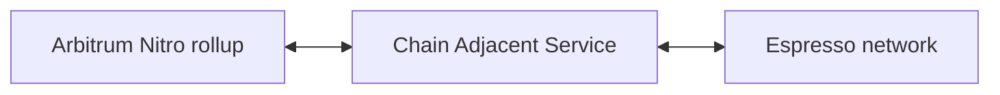
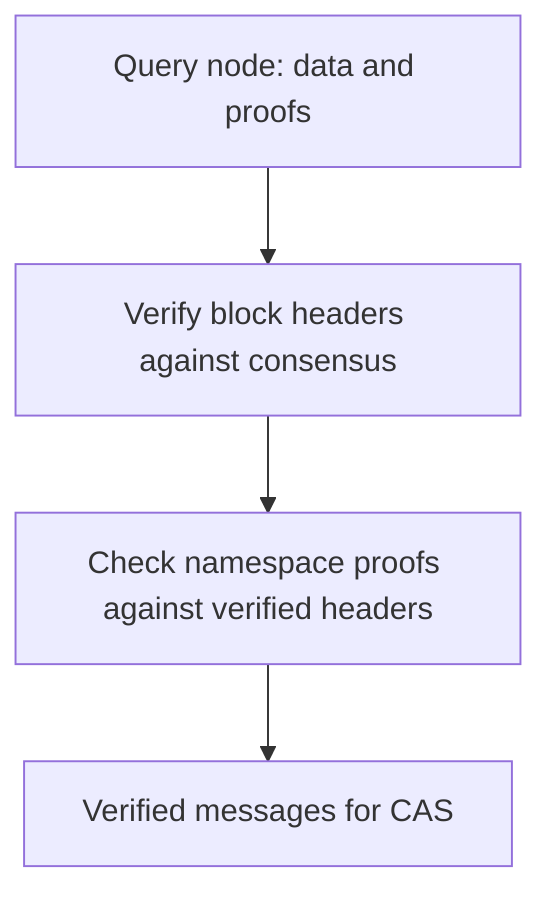
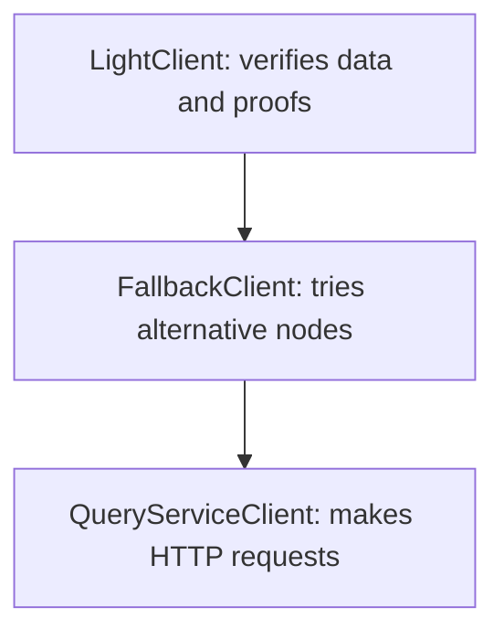

# CAS and the light client

CAS connects an Arbitrum Nitro rollup to Espresso. It submits rollup messages, verifies finalized Espresso data through the light client, and checks proposed batches against that verified stream before issuing a certificate.

## Components

The rollup produces transaction messages. Espresso's validators agree on finalized blocks: blocks accepted by the network's consensus protocol, HotShot. CAS connects the two systems and checks that rollup batches follow Espresso's agreed ordering.

A **namespace** identifies the transactions belonging to a rollup within Espresso blocks. CAS reads the namespace configured for that rollup.

## Message flow

CAS handles two directions of traffic:

- **Submission:** receives rollup feed messages, batches them into Espresso transactions, submits them and tracks their inclusion.
- **Consumption:** reads finalized transactions from Espresso, verifies them, and relays the corresponding messages to the rollup.

The light client protects the consumption path. CAS also checks the batch poster's proposed batch against this verified stream. A successful check lets CAS issue a signed certificate for on-chain validation.

## Verifying Espresso data

A query node serves data over HTTP. Its response alone does not prove that Espresso's validators agreed on that data. CAS uses the light client to check the evidence returned with each response.

A block header summarizes the block's contents. The client first establishes that the header belongs to a finalized block, then checks that the returned transactions match that header. A namespace proof can also establish that the namespace is empty.

Verification depends on the configured starting validator set, described below. It cannot force a query node to respond; an outage or withheld data can still stop progress.

## Where trust starts

The client needs to know which validators were allowed to finalize a block. Its trusted starting point is the **genesis stake table**: the initial validator set and stake weights supplied in the network configuration.

As validators change, the client reconstructs and checks later sets, starting from genesis or previously verified state. This process is called **catch-up**. The [catch-up guide](light-client-catchup.md) explains the checks and how to validate the genesis files.

CAS does not obtain its production starting validator set from the query node at startup. Some historical Decaf blocks require a limited exception, described in [historical Decaf compatibility](light-client-catchup.md#historical-decaf-compatibility-assumption).

## Verification and fallback

These layers have different responsibilities. Query clients fetch data; `FallbackClient` tries alternatives when a node is slow or unavailable. `LightClient` checks the responses before returning transactions to CAS.

The default CAS build uses this verified reader. A separate `unverified-reader` build trusts query responses; see [reader configuration](light-client-reference.md#cas-adapter-and-configuration) for how it is selected.

## Further reading

| Question | Document |
| --- | --- |
| Which source files, configuration fields and APIs implement this? | [Technical reference](light-client-reference.md) |
| How do validator sets change, and how can I verify genesis files? | [Catch-up and genesis guide](light-client-catchup.md) |
| How do I choose a Nitro version and build an enclave? | [Image builds](image-builds.md) |
